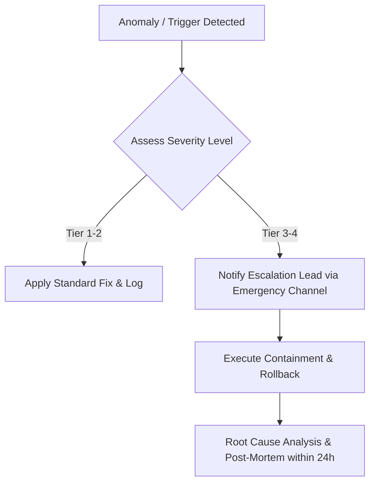

# Cultural Sensitivity Matrix

## Operational Playbook: Cross-Cultural Brand Safety & Taboo Avoidance Matrix for GCC/Egypt
Standard operating guidelines for **Cross-Cultural Brand Safety & Taboo Avoidance Matrix for GCC/Egypt** handling critical workflows and escalation thresholds.

### Scope & Mission
Build an open-source cross-cultural brand safety framework for MENA advertising: 1) Cultural sensitivity matrix across 6 core pillars (Religious Reverence, Gender & Social Representation, Body Language & Gestures, Idiomatic Subtext, National Pride & Sovereign Symbols, Seasonal Etiquette), 2) 35-point pre-publish creative review rubric, 3) 10 real-world case studies analyzing past advertising missteps and PR fallout.

---

## Multi-Tier Escalation Matrix

| Severity Level | Trigger Condition | Max SLA Response | Authorized Owner | Immediate Action Protocol |
| :--- | :--- | :--- | :--- | :--- |
| **Tier 1 (Low)** | Isolated metric anomaly (&lt; 10% variance) or minor ad comment inquiry | 4 Hours | Channel Specialist | Standard response or minor budget adjustment |
| **Tier 2 (Moderate)** | Discrepancy &gt; 25% or repeated negative sentiment cluster | 60 Mins | Senior Growth Lead | Pause anomalous ad sets; initiate data-layer triage |
| **Tier 3 (High)** | Platform policy strike, tracking outage, or critical SLA breach | 15 Mins | Head of Marketing | Activate holding statement; execute rollback playbook |
| **Tier 4 (Critical)** | Regulatory inquiry or complete revenue pipeline halt | Immediate (5m) | Executive Team | Full campaign freeze; incident commander assigned |

## Decision Logic Flow

---
*Operational standard maintained by @mahmoudabdelnaby1.*
